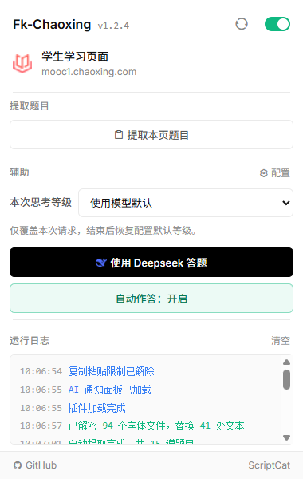

# Fk-Chaoxing 学习通助手 - Chrome 插件

Chrome 扩展，为超星学习通提供一键复制、字体解密、AI 自动答题等能力。基于 Manifest V3，全部逻辑在内容脚本中运行，零后端依赖。

好好学习天天向上！本插件仅供学习交流，使用者所产生的一切后果由使用者自行承担，与开发者无关。

<p align="center">
  
</p>

## 贡献
<p align="center">
  <a href="https://github.com/leoravyn"></a>
  <a href="https://github.com/Sukaetha"></a>
  <a href="https://github.com/Acidthing"></a>
  <a href="https://github.com/Flock-YT"></a>
  <a href="https://github.com/LLLeadstars"></a>
</p>

## 功能特性

- **解除限制**：解除复制/粘贴禁用、富文本编辑器限制、字体加密混淆
- **页面内 AI 对话**：可将整页、一题或多题加入上下文，指定作答目标；普通聊天显示回复，生成答案后展示可校验的候选答案
- **自动作答**：支持接入 OpenAI 兼容 API，批量识别并写入单选题、多选题、填空题、简答题、排序题、连线题及受支持的程序题编辑器
- **程序题上下文**：读取答题区现有代码与注释，保留换行和缩进；答题区变化时拒绝覆盖
- **多模型配置**：支持保存多个 AI 模型，可快速切换并执行连接测试
- **独立提示词**：每个模型可编辑完整作答提示词和独立对话提示词，支持恢复默认及发送预览
- **一键提取**：自动收集作业、考试、章节页面的题目

## 技术栈

- Manifest V3
- ES Module
- Shadow DOM 隔离样式
- MutationObserver + postMessage 跨 iframe 通信
- Chrome `storage.local` 本地配置持久化
- Chrome `permissions` + `optional_host_permissions` 动态申请 AI 接口域名权限

## 项目结构

```
Fk-Chaoxing-Extension/
├── manifest.json              # 扩展权限、内容脚本与可选 Host 权限声明
├── background.js              # 后台 Service Worker
├── popup.html                 # 弹窗 UI 结构
├── popup.css                  # 弹窗样式
├── popup.js                   # 弹窗控制器
├── content-message-handler.js # 统一消息路由
├── content.js                 # 内容脚本入口
├── injected.js                # 注入页面上下文
├── modules/
│   ├── logger.js              # 全局日志
│   ├── ui/                    # 可复用组件
│   │   ├── Modal.js
│   │   └── Toast.js
│   ├── extractors/            # 题目提取器
│   │   ├── HomeworkExtractor.js
│   │   └── ExamExtractor.js
│   ├── services/              # 业务聚合
│   │   └── QuestionCollector.js
│   ├── ai-answer/             # AI 答题子系统
│   │   ├── api.js
│   │   ├── chat.js             # 页面内对话模态窗与会话状态
│   │   ├── chat.css
│   │   ├── core.js
│   │   ├── index.js
│   │   ├── ui.js
│   │   └── dialogue.js
│   ├── PasteEnabler.js        # 破解粘贴限制
│   ├── CopyEnabler.js         # 字体解密
│   └── UEditorUnlock.js       # 富文本编辑器解锁
└── assets/
    ├── TyprMd5.js
    └── table.json
```


## 更新日志

见 [CHANGELOG.md](CHANGELOG.md)

## 快速开始

### 一、安装插件

1. 下载\克隆本仓库代码到本地
2. 打开 Chrome 浏览器，访问 `chrome://extensions/`
3. 开启右上角的"开发者模式"
4. 点击"加载已解压的扩展程序"
5. 选择本项目文件夹，点击"选择文件夹"
6. 插件图标将出现在浏览器工具栏


### 二、配置 AI 模型

首次使用 AI 答题功能前，需要先配置 AI 模型。

#### 步骤 1：打开插件配置

1. 点击浏览器工具栏上的插件图标
2. 在弹出的面板中点击“配置”，进入总体设置，再打开“模型管理”并点击“添加”

#### 步骤 2：填写 AI 配置

在模型编辑页填写以下信息：

| 配置项 | 说明 | 示例值 |
|--------|------|--------|
| **显示名称** | 给这个配置取个名字 | 答题助手 |
| **API 地址** | AI 服务的 base URL | `https://xxx.com/v1` |
| **API Key** | 你的 API 密钥 | `sk-xxxxxxxxxxxxxxxx` |
| **模型选择** | 在同一个框内输入模型 ID，或点击右侧箭头选择已拉取的模型 | `model-id` |
| **API 类型** | 每个模型配置独立选择协议 | `Chat Completions` / `Responses` / `Claude Messages` / `Gemini GenerateContent` |
| **请求路径** | 随 API 类型切换标准路径，自定义路径保留 | `/chat/completions`、`/responses`、`/messages`、`/models/{model}:{method}` |
| **默认思考等级** | 使用模型默认、不思考、Low、Medium、High、XHigh、Max | `High` |
| **温度系数** | 0–2，可留空；Chat Completions 默认 `0.3`，Responses 默认留空；显式指定思考等级时禁用并省略 | `0.3` |

“使用模型默认”不指定思考强度。其余等级按接口协议原值透传：Chat Completions 使用 `reasoning_effort`，Responses 使用 `reasoning.effort`，Claude Messages 使用 `output_config.effort`，Gemini GenerateContent 使用 `thinkingConfig.thinkingLevel`。

“不思考”在兼容协议中发送 `none`，Claude 原生接口发送 `thinking.type: "disabled"`，Gemini 原生接口发送 `thinkingBudget: 0`。

页面聊天、直接生成和主动提取答案均使用流式请求；连接测试及其他非流式入口共用同一套协议适配和结果解析。Responses 使用 `store: false`


| 厂商 | API 地址示例 | 协议与路径 |
|------|-------------|------------|
| OpenAI GPT | `https://api.openai.com/v1` | Responses，`/responses` |
| DeepSeek | `https://api.deepseek.com` | Chat Completions，`/chat/completions` |
| Claude | `https://api.anthropic.com/v1` | Claude Messages，`/messages` |
| Gemini | `https://generativelanguage.googleapis.com/v1beta` | Gemini GenerateContent，`/models/{model}:{method}` |
| Grok | `https://api.x.ai/v1` | Responses，`/responses` |
| Kimi | `https://api.moonshot.cn/v1` | Chat Completions，`/chat/completions` |
| GLM | `https://open.bigmodel.cn/api/paas/v4` | Chat Completions，`/chat/completions` |
| Qwen | `https://dashscope.aliyuncs.com/compatible-mode/v1` | Chat Completions，`/chat/completions` |

#### 步骤 3：保存与测试

1. 点击“保存”即可保存有效配置，无需保持网络连接
2. 需要检查连接时，单独点击“测试连接”；测试会发送“仅回复 OK”并可能产生费用
3. 首次测试或使用新 API 地址答题时，浏览器会请求对应域名权限

#### 步骤 4：多模型管理（可选）

- **新增模型**：在“模型管理”点击“添加”，填完后保存
- **切换模型**：在模型列表点击“使用”，下次对话请求采用当前模型
- **编辑或删除模型**：在模型列表打开编辑页后操作；离开未保存的编辑页会提示确认
- **作答提示词和对话提示词**：每个模型单独保存，可恢复默认。作答提示词是直接生成时实际使用的完整系统提示词，包含 JSON 示例、题型约束和程序题要求；修改后若返回格式不符合本地校验要求，不会填写。对话提示词独立控制讨论，本轮输入作为用户消息发送。“填入答案”使用内部专用规则，只整理讨论中明确的答案，不使用这两项自定义提示词。模型页可预览三种用途的模板，页面对话窗可预览含当前题目的实际发送内容。旧配置的系统、用户提示词保留为作答偏好，对话采用独立默认值

#### 大题库答题设置

在弹窗“配置 → 总体设置”中设置每次请求题目数（1–100）、同时并发数（1–16）、失败重试次数（0–5）和请求超时（正整数秒）。默认每次请求 50 题、同时并发 4 个请求、每次请求最多额外重试 2 次、超时 300 秒。设置对所有模型生效，任务开始后固定本次参数。

“生成答案”和“填入答案”按题目数及并发设置分批，每批独立请求；生成可以带上限内的辅助题目，提取只带当前批次题目及相关聊天最终回复，不带思考内容。讨论每轮使用一个完整请求，包含已加入的题目资料和保留的聊天记录，不按题目数拆分，也不再仅发送最近 12 条消息。重试和超时设置仍对讨论生效。预览展示实际发送内容；聊天记录最多持久化最近 60 条，题目资料独立保存，不随早期消息截断而丢失。

超时限制包含模型思考和输出的整次请求总时长，持续收到内容也不会重置；重试会重新计时。该设置也适用于模型连接测试和其他 AI 请求。
原生暂存能力缺失、失败或超时会暂停后续填写，保留已填内容并提示“暂存未确认”；不会用修改答题卡颜色代替暂存。停止会取消活动请求及待执行填写；已发出的单题暂存请求可能仍会完成。作业页保持原填写行为，最终交卷始终由用户操作，插件不会自动交卷。


### 三、使用 AI 答题

#### 页面内对话与生成答案

1. 打开超星学习通作业/考试/章节页面
2. 等待页面题目加载完成
3. 点击插件图标打开弹窗
4. 点击“使用 AI 答题”打开对话窗
5. 勾选整页或指定题目作为本轮待发送资料；输入区分别显示“本轮待发送”和“已加入对话”的题目，可再限定作答目标
6. 当前上下文尚未讨论时，输入框留空，主按钮为“生成答案”：一次生成结构化答案，校验通过后直接填写
7. 输入内容后，主按钮变为“发送”：只聊天，不自动填写。发送后自动取消本轮勾选，题目资料保留在对话中；后续不必重新勾选即可继续讨论。再勾选新题发送，即可补充资料。重选已加入题目不会重复保存，内容有变化时会更新并标明。讨论模式允许只发送题目、不输入文字，此时仅在本地加入资料，不调用模型；没有文字也没有待发送题目时不能发送。Enter 与点击主按钮相同，Shift+Enter 换行
8. 答案讨论确定后，点击“填入答案”：默认从全部已加入题目中，根据聊天记录提取每题最后明确的答案，也可限定一道题；校验后填写。未确定的题会提示未填写，不会临时补做。输入框有未发送内容时请先发送


#### 方式二：先提取再答题
1. 在超星页面，点击插件弹窗的"自动获取题目"按钮
2. 插件会收集所有题目并显示预览
3. 确认无误后打开 AI 对话窗，选择题目并发送对话或生成答案


### 四、提取题目

如果你只想收集题目（比如复制到其他地方），可以使用提取功能。

#### 步骤：

1. 打开超星页面
2. 点击插件图标
3. 点击"自动获取题目"按钮
4. 插件会：
   - 扫描页面所有题目
   - 自动复制到剪贴板
   - 显示预览弹窗
   - 插件图标右上角显示题目数量徽章


## 支持的页面类型

目前插件完整或部分支持以下超星页面：

| 页面类型 | URL 特征 | 支持状态 |
|----------|----------|----------|
| 章节学习 | `/mycourse/studentstudy` | 完全支持 |
| 作业作答（旧版） | `/work/doHomeWorkNew` | 完全支持 |
| 作业作答（新版） | `/mooc-ans/mooc2/work/dowork` | 完全支持 |
| 考试页面 | `/exam-ans/mooc2/exam/preview` | 完全支持 |
| 知识点 | `/knowledge/cards` | 完全支持 |

**注意**：如果你的作业页面显示"写入 0 题"，可能是因为该页面使用了新的 DOM 结构，请将相关页面 HTML 片段提供给开发者以便适配。

欢迎提交 Issue 和 PR！如果你发现新的超星页面结构不被支持，请提供相关 HTML 片段以便适配。
